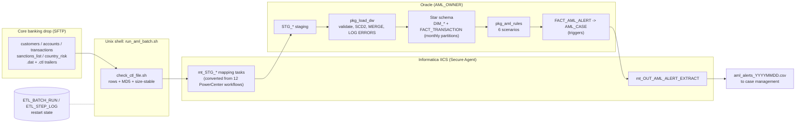

# AML Transaction Monitoring Pipeline (Informatica IICS + Oracle)

A nightly anti-money-laundering (AML) batch that lands core-banking extracts in Oracle, builds an AML star-schema warehouse, and runs six PL/SQL detection scenarios that raise alerts and roll them into investigator cases. The ingestion layer was migrated from Informatica PowerCenter to Informatica Intelligent Cloud Services (IICS), and the whole chain is driven by restartable Unix shell scripts.

All data is synthetic. Sanctioned names, thresholds and country tiers are fictional demo values.



## What is in the box

| Path | What it is |
|---|---|
| `data_generator/generate_transactions.py` | Synthetic extract generator: 50K accounts, 2M transactions over 30 days, with labelled structuring, rapid-movement, sanctions (with typos), prohibited-country, dormant-account and large-cash patterns. Writes `.ctl` trailers (row count + MD5) and a ground-truth file. |
| `sql/01_ddl/` | ETL control tables, staging, star schema (SCD2 customer dim, interval-partitioned fact, alert/case tables), triggers, seed data. |
| `sql/02_plsql/` | Packages `pkg_aml_util`, `pkg_etl_control`, `pkg_load_dw`, `pkg_aml_rules`, plus reporting views. |
| `sql/tests/test_aml_rules.sql` | End-to-end PL/SQL test: one fixture per rule, asserts alerts, reruns to prove idempotency, checks the delete guard, cleans up. |
| `informatica/powercenter_legacy/` | The 12 legacy PowerCenter workflow exports (XML). |
| `tools/pc_to_iics/convert_pc_to_iics.py` | Conversion assistant: PowerCenter XML to IICS mapping, mapping task and taskflow specs, plus a findings report. |
| `informatica/iics/` | Converter output: 12 mappings, 12 mapping tasks, 12 taskflows, `conversion_report.md`, `conversion_inventory.csv`. |
| `informatica/iics_orchestration/` | Hand-built production assets: `tf_AML_NIGHTLY` taskflow, generic SQL-call mapping, connections, parameter-file template. |
| `scripts/` | `run_aml_batch.sh` (orchestrator), `check_ctl_file.sh`, `archive_files.sh`, `setup_db.sh`, `lib/common.sh`, `lib/iics.sh` (IICS REST client). |
| `sqlldr/` | SQL*Loader control files used in LOCAL mode in place of the IICS staging tasks. |
| `tests/` | pytest suite: generator contract, converter, shell scripts, and a Python reference model of the rules that measures recall against ground truth. |

## Detection scenarios

Thresholds live in `AML_RULE_CONFIG`, so tuning never needs a code release, and `trg_rule_config_hist` versions every change.

| Rule | Logic (default thresholds) | Severity |
|---|---|---|
| `STRUCTURING` | 3+ cash deposits each between $8,000 and $10,000 within 5 days, totalling over $10,000 | HIGH |
| `LARGE_CASH_CTR` | Single cash transaction over $10,000 | MEDIUM |
| `RAPID_MOVEMENT` | Credit of $25,000+ with 85%+ of it wired out within 2 days | HIGH |
| `SANCTIONS_MATCH` | Wire counterparty matches an active watchlist entry with Jaro-Winkler score of 90+ on normalised names (`UTL_MATCH`) | CRITICAL |
| `HIGH_RISK_GEO` | Wire to or from a PROHIBITED jurisdiction | CRITICAL |
| `DORMANT_REACTIVATION` | Account idle 180+ days that moves more than $10,000 | MEDIUM |

Risk score = rule base score, plus points for HIGH/MEDIUM KYC rating, PEP status and amounts of $100K+, capped at 100. Alerts for the same customer attach to one open case; the case priority escalates to the worst alert's severity.

## Design choices worth knowing

**Restart from the failed step.** `pkg_etl_control.start_batch` reuses the batch id of a FAILED night and bumps `attempt_no`. `run_aml_batch.sh` checks `ETL_STEP_LOG` before each of its 16 steps and skips anything already `SUCCEEDED`. A failure in the rules step reruns only the rules, not the 2M-row staging and fact loads.

**Every step is idempotent.** Staging loads truncate their table; the fact load skips existing `TXN_ID`s; alerts have a natural key `(rule_code, account_key, window_start_date)` and every rule inserts with `NOT EXISTS`. Rerunning any step, or the whole night, cannot create duplicate alerts or double-count cases. The PL/SQL test proves this by running the rules three times.

**Bad rows are quarantined, not fatal.** The fact insert uses `LOG ERRORS INTO ERR$_FACT_TRANSACTION REJECT LIMIT UNLIMITED`; orphan accounts go to `ETL_ERROR_LOG`. The step fails only if rejects exceed 1% (`pkg_load_dw.c_max_reject_ratio`). Control-file reconciliation fails the batch if loaded rows differ from the trailer count.

**Regulatory guard rails in triggers.** Alerts cannot be deleted (`trg_alert_bd`), evidence columns are immutable, closed alerts cannot be reopened, every status change is written to `AML_ALERT_AUDIT`, and a case cannot close without a disposition.

**Logic stays in the database.** IICS moves files into Oracle and the alert extract out; set-based transforms, SCD2 and rules run in PL/SQL (pushdown). The IICS taskflow calls the same procedures through `m_SQL_CALL_PROCEDURE`, so the logic is identical whichever tool drives the run.

## Quick start (LOCAL mode, no IICS needed)

Requirements: Docker, Python 3.10+, Oracle Instant Client 19c+ with `sqlplus` and `sqlldr` on `PATH`, `flock`, `md5sum`.

```bash
cp config/aml_pipeline.env.example config/aml_pipeline.env   # set AML_DB_PASSWORD
export ORACLE_SYSTEM_PASSWORD='ChangeMe_Sys1'

make db-up          # Oracle 23ai Free in Docker
make db-install     # creates AML_OWNER, installs objects, runs the PL/SQL unit test
make data DATE=20260930
make run-local DATE=20260930
```

The run log ends with a step summary and alert counts per rule. The alert file lands in `data/outbound/aml_alerts_20260930.csv`.

To see restart behaviour, make the rules step fail, then fix it and rerun:

```sql
-- every new case insert now violates this, so RUN_AML_RULES fails
ALTER TABLE aml_case ADD CONSTRAINT tmp_break CHECK (priority = 'NONE') ENABLE NOVALIDATE;
```

```bash
make run-local DATE=20260930     # fails at step 60, batch marked FAILED
```

```sql
ALTER TABLE aml_case DROP CONSTRAINT tmp_break;
```

```bash
make run-local DATE=20260930     # same batch id, attempt 2: steps 10-51 skipped, resumes at 60
```

Useful queries:

```sql
SELECT * FROM v_etl_run_status ORDER BY batch_id DESC, step_seq;   -- step timings and row counts
SELECT * FROM v_alert_summary ORDER BY alert_date DESC, rule_code; -- alert volumes
SELECT * FROM v_case_queue;                                        -- investigator work queue
```

## IICS mode

1. Create the three connections in `informatica/iics_orchestration/connections/` on your Secure Agent runtime environment.
2. Build the mappings and mapping tasks from the specs in `informatica/iics/` (start with `conversion_report.md`, which lists the items that need a developer, such as the unconnected lookup in `m_DIM_ACCOUNT_LOAD`). Informatica's free IICS trial is enough for this.
3. Set `IICS_USERNAME`, `IICS_PASSWORD`, `IICS_LOGIN_URL` (your pod) and `IICS_PARAM_DIR` in `config/aml_pipeline.env`.
4. `make run-iics DATE=20260930`

`lib/iics.sh` logs in through the v2 REST API, renders the parameter file with the batch id, starts each mapping task, polls the activity log, re-logs in if the session expires during a long run, and records IICS row counts and run ids in `ETL_STEP_LOG`.

## PowerCenter to IICS conversion

```bash
make convert        # or: python tools/pc_to_iics/convert_pc_to_iics.py --strict
```

For each workflow export the converter:

- merges each Source Qualifier into the IICS Source (SQL overrides become Query sources, filters carry over)
- folds Update Strategy into the target operation (Insert, Update, Upsert, or Data Driven with the original condition)
- converts Stored Procedure transformations to SQL transformations, keeps lookups, routers, sorters and sequences
- replaces `$PMSourceFileDir` style variables with in-out parameters and maps connections through `connection_map.json`
- turns Command tasks and post-session commands into taskflow Command Tasks and mapping-task post-processing commands
- flags what it cannot convert safely: unconnected or reusable objects missing from the export, `SETVARIABLE`, `:SP.` calls, session variables, custom link conditions

Current result: 12 workflows, 1 fully automatic, 10 automatic with review notes, 1 needing manual work. `--strict` exits with code 2 while any manual item remains, which makes it usable as a CI gate.

## Tests

```bash
make test           # 42 Python/shell tests (shellcheck included when installed), about 10 seconds, no database
make db-test        # PL/SQL end-to-end test against Oracle
```

The Python reference model (`tests/reference_rules.py`) re-implements the six rules, the name normaliser and Jaro-Winkler, and asserts at least 95% recall on every injected pattern and zero false positives for structuring, sanctions, geography and dormancy on background traffic. It runs in CI without Oracle and catches drift between the generator and the thresholds.

## Scheduling

`scheduler/crontab.example` runs the chain at 02:15 and retries at 05:30. The retry is harmless after a successful night because `start_batch` refuses a date that already succeeded unless `-f` is given. An `flock` lock stops overlapping runs.

## Limitations

- The IICS JSON files are readable specifications, not IICS export packages. Build the assets in the Mapping Designer from them, or template them into an export.
- The SQL has been written for Oracle 19c+ (`VALIDATE_CONVERSION`, `LISTAGG DISTINCT`, `TO_DATE ... DEFAULT ON CONVERSION ERROR`). Run `make db-install` to compile and test it against your instance.
- Thresholds are illustrative, not tuned. A real programme calibrates them with above/below-the-line testing.
